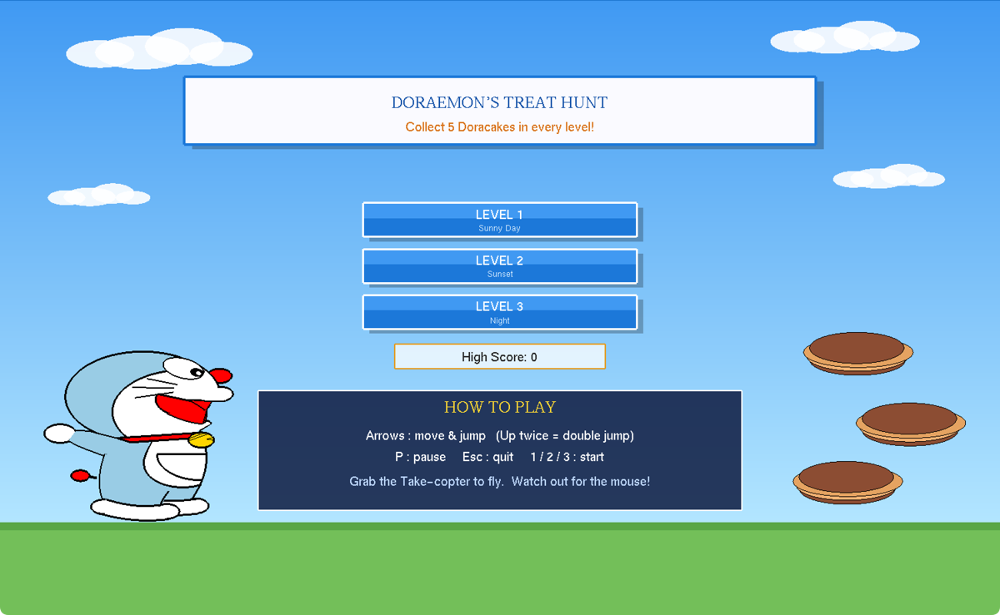
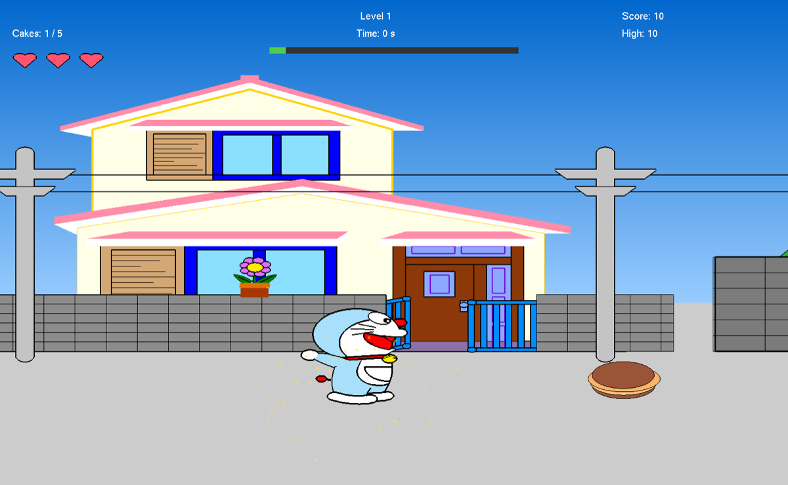
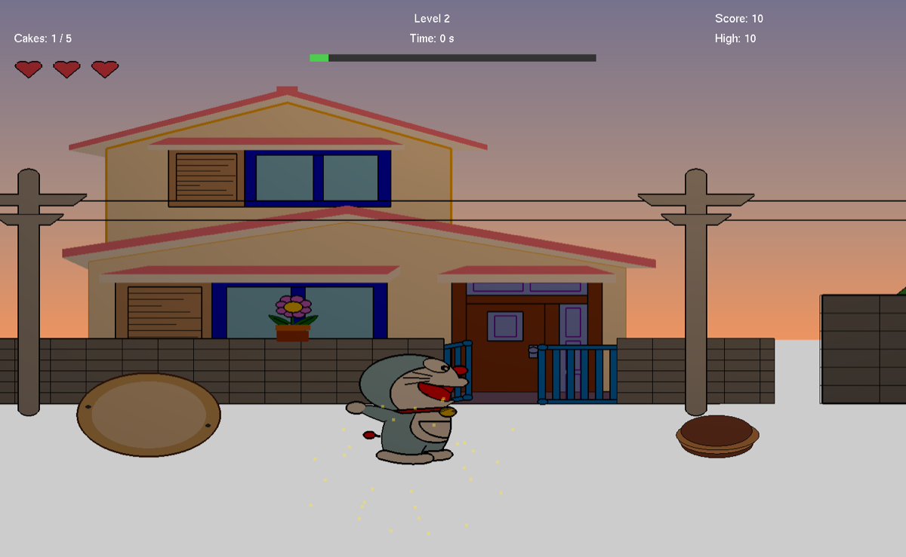
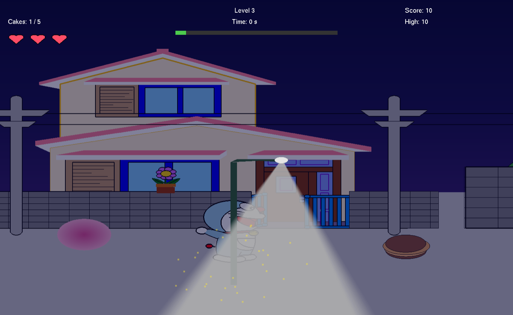

<div align="center">

# 🎮 Doraemon's Treat Hunt


**A 2D Side-Scrolling Adventure Game**

Built with C++, OpenGL and GLUT for the Computer Graphics course at AIUB

[Features](#-features) • [Installation](#-installation) • [How to Play](#-how-to-play) • [Screenshots](#-screenshots) • [Documentation](#-documentation)



</div>

---

## 📖 About The Project

**Doraemon's Treat Hunt** is a 2D side-scrolling game developed with OpenGL and GLUT as our Computer Graphics course project at American International University-Bangladesh (AIUB), Fall 2025-26. The player guides Doraemon through a scrolling town across **3 levels**, collecting **5 Doracakes** in each level while avoiding level-specific hazards.

Every object in the game, from Doraemon to the houses, lamp posts and trees, is drawn from OpenGL primitives and parametric curves. No image textures or sprites are used.

### 🎯 Project Objectives

- Apply core Computer Graphics concepts in a real, interactive program
- Build a real-time graphics application with a smooth game loop
- Implement game mechanics: gravity, collision detection, animation and input handling
- Draw every visual with OpenGL primitives instead of external images

---

## ✨ Features

### 🎮 Gameplay Features

- **3 levels** with their own sky, lighting and hazards
- **Side-scrolling movement** with gravity-based jumping and **double jump**
- **Collectibles:** gather 5 Doracakes per level to clear it
- **Lives system:** 3 hearts; extra hearts on the road restore a lost life
- **Take-copter power-up:** pick it up to fly for about 5 seconds
- **Mouse enemy:** Doraemon is scared of mice and runs the other way when one gets close
- **Level-specific hazards:**
  - Level 1: stones on the road
  - Level 2: rotating sign boards and manhole fires that switch on and off
  - Level 3: moving balls, mice and spiky fruit

### 🎨 Visual Features

- Hand-drawn graphics using OpenGL primitives (`GL_POLYGON`, `GL_TRIANGLE_FAN`, `GL_LINES` and more)
- Character, houses, trees, lamp posts and clouds built from circles, ellipses, curves and polygons
- Progressive themes: **Sunny Day → Sunset → Night**
- Lighting effects: warm sunset glow and street-lamp light at night
- Particle effects when collecting items, a red flash when hit and blinking during invincibility
- HUD with lives, time, score and a level progress bar

### 🔊 Audio Features

- Sound effects for collecting Doracakes, getting hit, level complete, game over, the Take-copter and the mouse scare
- macOS uses built-in system sounds, so no extra files are needed
- Windows plays WAV files from a `sounds` folder

### 💾 Game Systems

- **Score:** +10 points per Doracake
- **Time bonus:** finish a level in under 60 seconds to earn +2 points for every second left
- **High score** saved in `highscore.txt` and kept between sessions
- **Pause** (P), level complete and game over screens
- **Invincibility frames** after taking damage

---

## 🛠️ Technologies Used

| Component | Technology |
| --- | --- |
| Language | C++ (C++11) |
| Graphics API | OpenGL (fixed-function pipeline) |
| Windowing & Input | GLUT / freeGLUT |
| Audio | `afplay` (macOS), `PlaySound` / winmm (Windows) |
| Build | Makefile (macOS, Linux), Xcode, any C++ IDE on Windows |
| Platform | macOS, Linux, Windows |

---

## 📋 Requirements

- A C++ compiler with C++11 support (Clang, GCC or MinGW)
- OpenGL and GLUT libraries
  - **macOS:** included with the system
  - **Linux:** `freeglut3-dev`
  - **Windows:** [freeGLUT](https://freeglut.sourceforge.net/), plus `opengl32`, `glu32` and `winmm`

---

## 🚀 Installation

### Step 1: Clone the Repository

```sh
git clone https://github.com/sadiaahmed9735/doraemon-treat-hunt-cg-project.git
cd doraemon-treat-hunt-cg-project
```

### Step 2: Build and Run

**macOS**

```sh
make run
```

The project can also be opened in Xcode.

**Linux**

```sh
sudo apt-get install freeglut3-dev
make run
```

**Windows (MinGW)**

```sh
g++ -std=c++11 -o doraemon-treat-hunt main.cpp -lfreeglut -lopengl32 -lglu32 -lwinmm
doraemon-treat-hunt.exe
```

### Step 3 (Windows only): Add Sound Files

Create a `sounds` folder next to the executable and add these files:

```
sounds/
├── collect.wav     # Doracake collected
├── hit.wav         # Hit by a hazard
├── levelup.wav     # Level complete
├── gameover.wav    # Game over
├── gadget.wav      # Take-copter picked up
└── scared.wav      # Scared by a mouse
```

---

## 🎮 How to Play

### Controls

| Key | Action |
| --- | --- |
| Left / Right arrow | Move |
| Up arrow | Jump (press twice for a double jump, hold to fly with the Take-copter) |
| P | Pause or resume |
| Esc | Back to the main menu (quit from the menu) |
| 1 / 2 / 3 or Enter | Start a level from the menu |
| R | Restart from the end screen |
| Mouse click | Menu and end-screen buttons |

### Objective

- Collect all **5 Doracakes** in a level to complete it
- Avoid hazards to keep your **3 hearts**
- Finish quickly to earn a **time bonus**
- Clear all **3 levels** to win the game

### Level Themes

| Level | Theme | Hazards |
| --- | --- | --- |
| 1 | ☀️ Sunny Day: bright daylight and clouds | Stones on the road |
| 2 | 🌇 Sunset: warm evening light | Rotating sign boards, manhole fires |
| 3 | 🌙 Night: dark street lit by lamps | Moving balls, mice, spiky fruit |

---

## 📸 Screenshots

| Level 1: Sunny Day | Level 2: Sunset | Level 3: Night |
| --- | --- | --- |
|  |  |  |

---

## 🏗️ Project Structure

```
doraemon-treat-hunt-cg-project/
├── main.cpp                              # Game source code
├── Makefile                              # Build script for macOS and Linux
├── highscore.txt                         # Saved high score (auto-generated)
└── docs/
    ├── Doraemons-Treat-Hunt-Report.pdf   # Project report
    └── screenshots/                      # Game screenshots
```

---

## 🔧 Key Implementation Details

### Graphics Rendering

- All visuals drawn with OpenGL primitives, no texture mapping
- Circles, ellipses and curves built from `cos` / `sin` points
- Coordinate system: `gluOrtho2D(-9.5, 9.5, -10.0, 10.0)`
- Window size: 1500 × 1000

### Game Loop

- About 60 FPS using a 16 ms GLUT timer
- `display()` draws the current frame
- `update()` moves objects, applies gravity and checks collisions

### Collision Detection

- Collectibles (Doracakes, hearts): distance-based radius check
- Hazards: rectangular bounding-box intersection
- 45 invincibility frames (about 0.75 seconds) after a hit

### File Management

- The high score is stored as plain text in `highscore.txt`
- It is saved whenever a new high score is reached

---

## 📚 Documentation

### Key Functions

| Function | Purpose |
| --- | --- |
| `Doraemon()` | Draws the main character from primitives |
| `homeScreen()` | Draws the main menu with level buttons |
| `Level1()` to `Level3()` | Draw each level's scene and hazards |
| `checkCollectibles()` | Detects Doracakes and heart pickups |
| `checkObstacles()` | Handles collisions with hazards |
| `updateObstacles()` | Animates moving hazards |
| `checkGadget()` | Handles the Take-copter power-up |
| `updateMouseEnemy()` | Moves the mouse and triggers the scare |
| `drawHUD()` | Draws lives, time, score and progress |
| `playSound()` | Plays a sound effect |
| `loadHighScore()` / `saveHighScore()` | Read and write the high score |

### Architecture

The game follows an event-driven architecture:

1. **Initialization** (`init()`): set up OpenGL state and the coordinate system
2. **Main loop** (`glutMainLoop()`): process events
3. **Display callback** (`display()`): render the frame
4. **Timer callback** (`update()`): game logic, about 60 times per second
5. **Input handlers** (`specialKeyPress()`, `keyPress()`, `mouseClick()`): user interaction

The full project report, with a detailed description of each level and every function used, is in [docs/Doraemons-Treat-Hunt-Report.pdf](docs/Doraemons-Treat-Hunt-Report.pdf).

---

## 🐛 Known Limitations

- Game speed depends on the computer's frame rate, so it can run slightly faster on fast machines.
- Collision uses simple rectangular boxes, so contact with round objects is approximate.
- Resizing the window stretches the scene instead of keeping its proportions.
- Text uses fixed-size bitmap fonts that do not scale with the window.
- There is no background music, and sound effects need extra WAV files on Windows and are not available on Linux.
- Only the high score is saved; level progress is not.

---

## 🔮 Future Enhancements

- [ ] Frame-rate-independent movement using elapsed time
- [ ] Two new levels: a rainy dawn with falling stones and a stormy night with ghosts and lightning
- [ ] Easy, Normal and Hard difficulty modes
- [ ] More Doraemon gadgets: Anywhere Door, Small Light and Air Cannon
- [ ] Parallax scrolling background for a sense of depth
- [ ] Background music and sound on all platforms

---

## 🎓 Academic Information

| | |
| --- | --- |
| **Course** | Computer Graphics |
| **Course Teacher** | Tonny Shekha Kar |
| **Semester** | Fall 2025-26 |
| **Department** | Computer Science, American International University-Bangladesh |

### 👥 Project Team

| Name | Student ID | Role |
| --- | --- | --- |
| Sadia Ahmed | 23-55053-3 | Member |
| Orpyta Karmokar Aupy | 23-55051-3 | Member |
| Tasmia Amin | 23-53122-3 | Member |

---

## 🙏 Acknowledgments

- Our course teacher for guidance and support
- The OpenGL and freeGLUT communities for their documentation
- The Doraemon franchise for the character inspiration (fan project, non-commercial)

---

<div align="center">

Made with ❤️ using OpenGL and C++

⭐ If you found this project helpful, please give it a star! ⭐

</div>
